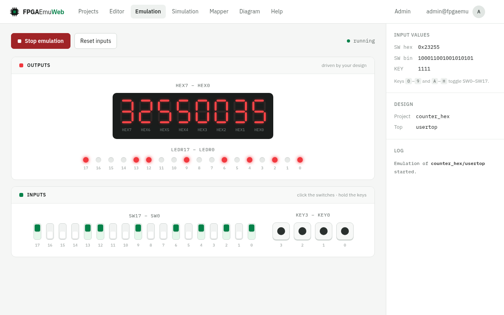
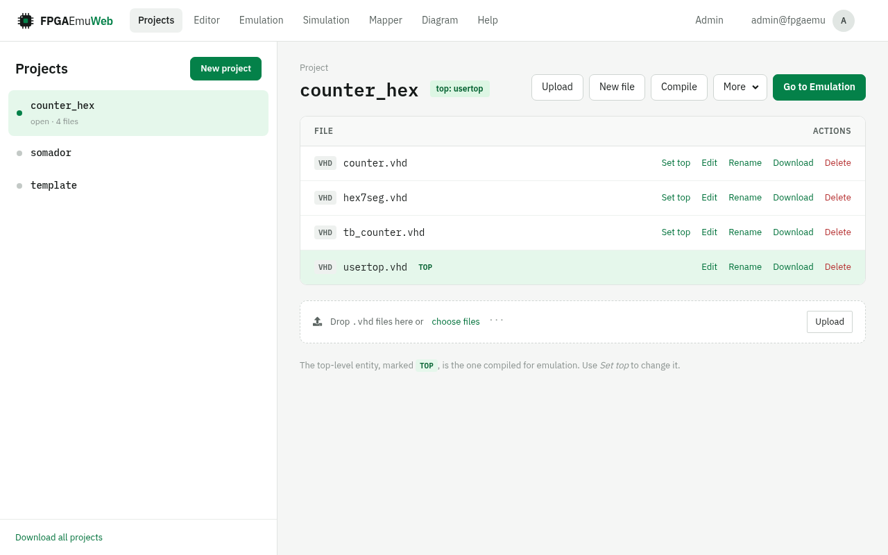
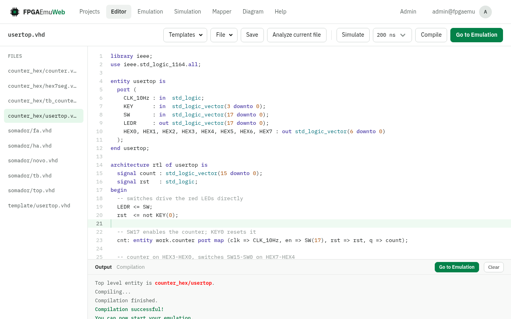
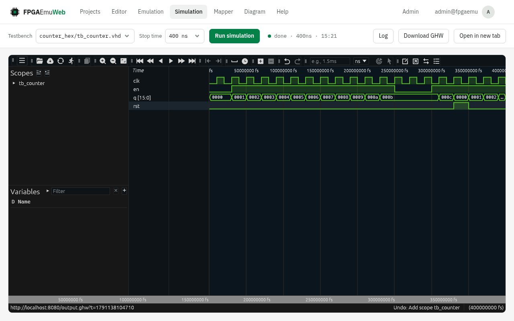
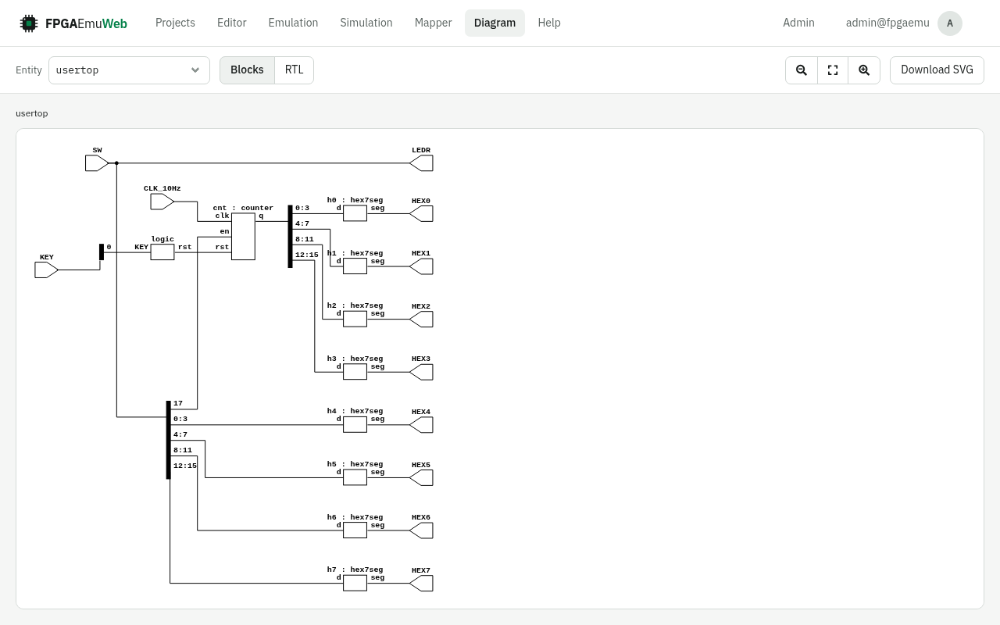

<p align="center"></p>
<h1 align="center">FPGAEmuWeb</h1>
<p align="center"><b>VHDL emulation and simulation in the browser</b><br>edit · analyze · compile · emulate · simulate</p>

FPGAEmuWeb is a web-based VHDL environment built on [GHDL](https://github.com/ghdl/ghdl): students write VHDL in the browser, compile it and run it on an emulated DE2-style board (switches, keys, LEDs and seven-segment displays), simulate testbenches and inspect the waveforms, all without installing anything.



## Features

- **Projects and editor**: VHDL files organized in projects, with an editor ([Ace](https://ace.c9.io/)) that highlights syntax and analyzes or compiles the project in one click.
- **Emulation**: the top-level entity drives 8 seven-segment displays and 18 LEDs, and reads 18 switches and 4 keys, in real time. Ports can be remapped with the **Mapper**.
- **Simulation**: runs a testbench and shows the result in the [Surfer](https://surfer-project.org/) waveform viewer; the `.ghw` file can also be downloaded for [GTKWave](https://gtkwave.sourceforge.net/).
- **Diagrams**: any synthesizable entity drawn as blocks (its components) or RTL (gates, multiplexers, flip-flops), with navigation into sub-blocks, and its state machines drawn as state diagrams, with the transition conditions as written in the code.
- **Classes**: user accounts, roles (student, professor, admin) and the *view as* mode for professors to open students' projects.

| Projects | Editor |
|---|---|
|  |  |
| **Simulation** | **Block diagram** |
|  |  |

## Running

### Docker (recommended)

```
docker compose build
docker compose up -d
```

FPGAEmuWeb is then available at http://127.0.0.1 (port 80). The image includes GHDL, the Surfer viewer and everything else.

### Locally

Requires GHDL 3.0 or later (with synthesis support, `ghdl --synth`, for the block diagrams) and [uv](https://docs.astral.sh/uv/):

```
uv sync
uv run python start.py debug
uv run huey_consumer worker.huey    # background tasks, in another terminal
```

FPGAEmuWeb is then available at http://127.0.0.1:5000. The Surfer waveform viewer is only bundled in the Docker image (`static/surfer_wasm/dist`); without it, download the simulation result instead.

In both cases, sign in with **admin@fpgaemu** / **admin** and change this password after the first login.

## First steps

1. In **Projects**, create a project and a file named `usertop.vhd`.
2. In the **Editor**, open the file, choose **Templates › usertop.vhd** and save.
3. Click **Compile**; when it succeeds, click **Go to Emulation**.
4. Click **Start emulation** and play with the switches (keys `0`–`9` and `A`–`H` also toggle them).

## Deployment notes

- **Data on network storage**: with `ENVCACHEDWORK=True` (as built by the CI), the app works on a local copy of its data and [worksync.py](worksync.py) keeps it in sync with the `work/` volume, so a slow or stalled NFS share does not freeze the site.
- **Diagnostics**: [diagnostics/diagnose.py](diagnostics/diagnose.py) checks disks, files, databases, the toolchain and processes at every start; the report is in the admin page and at `/diagnostics`.

## Authorship

Developed by [Prof. Eduardo L. O. Batista](https://eduardobatista.github.io/). The emulation backend is based on [FPGAEmu](https://fabian.paginas.ufsc.br/pt/tools/fpgaemu/) by [Prof. Fabian L. Cabrera](https://fabian.paginas.ufsc.br/pt/). Both are professors at the [Department of Electrical and Electronics Engineering](http://www.eel.ufsc.br) of the [Federal University of Santa Catarina (UFSC)](http://www.ufsc.br), Florianópolis, Brazil.
